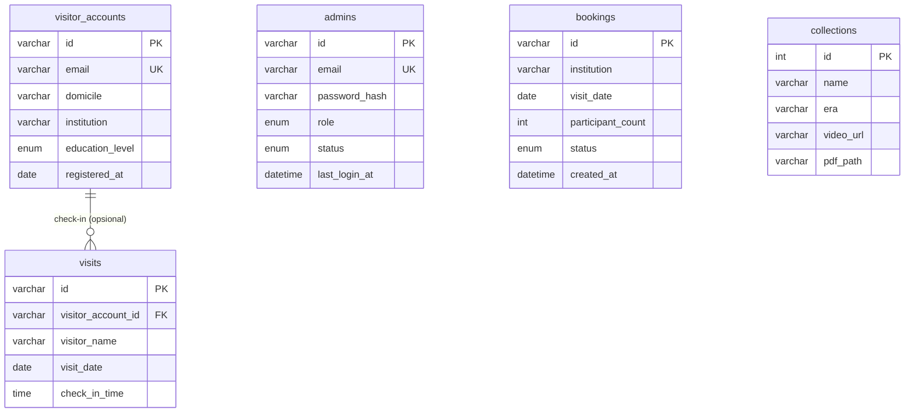

# Database · Admin Web Museum Mpu Purwa

Skema dan data awal database untuk **Admin Web Museum Mpu Purwa**. Repositori ini bagian dari proyek yang dipecah menjadi tiga repositori:

| Repositori | Isi |
|---|---|
| `museum-mpupurwa-frontend` | Next.js (tampilan admin web) |
| `museum-mpupurwa-backend` | Express.js + TypeScript (API) |
| `museum-mpupurwa-database` | **repositori ini**: skema, data awal, dan query |

> Saat ini (UTS) backend masih memakai data dummy di memori. Repositori ini menyiapkan database yang akan menggantikannya, dengan bentuk data yang sama persis dengan yang dipakai API, sehingga tampilan admin web tidak berubah.

## Teknologi

**MySQL 8.0+** atau **MariaDB 10.4+** (versi bawaan XAMPP dan Laragon juga bisa), `utf8mb4`.

## Isi repositori

| Berkas | Fungsi |
|---|---|
| `schema.sql` | Membuat database `museum_mpupurwa`, semua tabel, indeks, dan view |
| `seed.sql` | Data awal: sama dengan data dummy yang dipakai backend sekarang |
| `queries.sql` | Query untuk tiap endpoint API (pengganti `backend/src/data/*`) |

## Cara menjalankan

Pastikan MySQL/MariaDB sudah berjalan, lalu dari folder ini:

```bash
mysql -u root -p < schema.sql
```

```bash
mysql -u root -p < seed.sql
```

(Di XAMPP tanpa kata sandi, hilangkan `-p`.) Atau buka kedua berkas di phpMyAdmin / MySQL Workbench dan jalankan berurutan: **`schema.sql` dulu, baru `seed.sql`**.

> **Peringatan:** `schema.sql` menjalankan `DROP TABLE`, jadi menjalankannya ulang menghapus semua data. Pakai hanya untuk database development.

Akun untuk login setelah seed dimuat:

| Email | Kata sandi | Peran |
|---|---|---|
| `admin@mpupurwa.test` | `admin123` | Super Admin |

Dua admin lain di seed (`dewi@mpupurwa.id`, `hadi@mpupurwa.id`) memakai kata sandi yang sama. Semuanya hanya untuk development. Jangan pernah memakai `seed.sql` di server sungguhan.

## Diagram relasi (ERD)



Hanya `visits` yang punya foreign key (ke `visitor_accounts`, boleh kosong). Tabel lain berdiri sendiri.

## Tabel dan halaman yang memakainya

| Tabel | Isi | Dipakai oleh |
|---|---|---|
| `admins` | Akun pengelola museum | Login, Manajemen Akun › Admin |
| `visitor_accounts` | Akun pengunjung dari aplikasi mobile | Manajemen Akun › Pengunjung, kartu "Total akun" |
| `visits` | Satu baris per check-in | Pengunjung Hari Ini, grafik Statistik Pengunjung |
| `bookings` | Pengajuan kunjungan rombongan | Booking Rombongan, kartu "Booking menunggu", diagram Status Booking |
| `collections` | Arca dan prasasti | Manajemen Koleksi, kartu "Koleksi terdaftar" |
| `v_collections` (view) | `collections` + label "Lengkap / Belum ada video / ..." | Kolom "Video & PDF" |

Notifikasi di lonceng navbar tidak punya tabel: dibentuk dari booking `pending` dan akun pengunjung terbaru (lihat bagian terakhir `queries.sql`).

## Keputusan desain

- **ID mengikuti format API**: `ADM-001`, `ACC-001`, `VIS-001`, dan id booking seperti `sdn1`. Backend yang membuat id baru (mis. `ADM-004`). Hanya `collections` yang memakai angka otomatis.
- **`visits` menyalin data pengunjung** (nama, domisili, institusi, jenjang) saat check-in. Riwayat tidak berubah kalau akunnya diedit atau dihapus, dan pengunjung tanpa akun tetap bisa tercatat.
- **Status booking** memakai empat nilai: `pending`, `confirmed`, `completed`, `rejected`. Nilai lain ditolak oleh database.
- **Kata sandi** disimpan sebagai hash bcrypt di `password_hash`, bukan teks asli.
- **Label media koleksi** tidak disimpan. Dihitung dari ada atau tidaknya `video_url` dan `pdf_path` (keduanya `NULL` kalau belum diunggah).

## Catatan tentang data seed

- **Email admin utama.** Di data dummy backend, akun yang dipakai login (`admin@mpupurwa.test`) berbeda dengan email yang tampil di daftar admin (`rizal@mpupurwa.id`) untuk orang yang sama. Seed memakai `admin@mpupurwa.test` supaya login tetap berfungsi.
- **Telepon pengunjung** di seed masih bentuk tersamarkan (`0812-xxxx-3421`) karena begitu data dummy-nya. Di database sungguhan simpan nomor utuh, dan API yang menyamarkannya.
- **Alamat video dan PDF koleksi** di seed adalah pengisi (`example.com`), hanya supaya status "Lengkap" tampil seperti sekarang. Kolom periode, asal, ukuran, dan makna dibiarkan kosong karena data dummy tidak memilikinya.
- **Pengunjung hanya hari ini.** Seed memuat 10 check-in untuk hari saat seed dijalankan. Riwayat harian untuk grafik 7 dan 30 hari terisi sendiri seiring check-in nyata. Angka agregat dummy (mis. "1.204 akun terdaftar") tidak ikut di-seed.
- **Waktu pengajuan booking** di seed dihitung mundur dari saat seed dijalankan (5 jam sampai 25 hari), sama dengan data dummy backend.
- Semua waktu disimpan sebagai waktu setempat (WIB).

## Menghubungkan ke backend

Belum dilakukan di backend. Saat UAS, backend perlu menambah driver MySQL (mis. `mysql2`) dan variabel koneksi di `.env`, misalnya:

```
DB_HOST=localhost
DB_PORT=3306
DB_USER=root
DB_PASSWORD=
DB_NAME=museum_mpupurwa
```

lalu mengganti isi fungsi di `backend/src/data/*` dengan query dari `queries.sql`. Bentuk respons API tidak perlu berubah.
